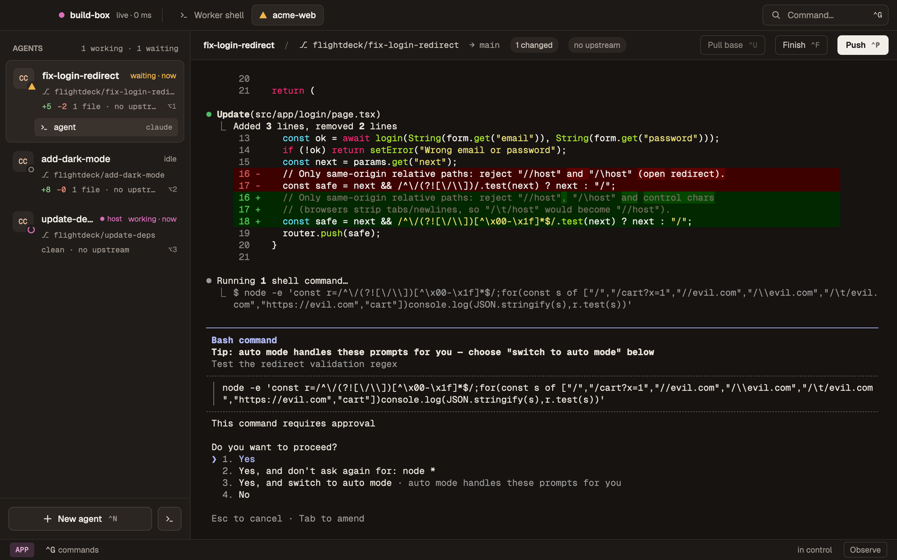

# FlightDeck

**FlightDeck runs several AI coding agents side by side** (Claude Code, Codex,
OpenCode, Cursor, or your own) and lets you watch and steer all of them from one
window. Every agent gets its own Git worktree and branch, so two agents never
edit the same files, and FlightDeck never commits, rewrites history or
force-pushes for you.



📖 **Documentation: [flightdeckai.app/docs](https://www.flightdeckai.app/docs)**

## Pick a setup

| | Where the agents run | You need |
| --- | --- | --- |
| **Desktop + a worker** (recommended) | an always-on Mac or Linux machine; your laptop is only the screen | FlightDeck Desktop, the `flightdeck` CLI on the worker, [Tailscale](https://tailscale.com) on both |
| **Desktop on its own** | your own computer | FlightDeck Desktop |
| **Terminal only** | your computer, or a worker via `flightdeck connect` | the `flightdeck` CLI |

All three are the same workspace with the same shortcuts. You can start with
the Desktop on its own and add a worker later.

You also need Git and at least one agent CLI (`claude`, `codex`, `opencode` or
`cursor-agent`), installed and logged in, on whichever machine runs the agents.

## Install

**FlightDeck Desktop** (macOS, Windows, Linux): download the latest
"FlightDeck Desktop" release from
[GitHub Releases](https://github.com/neworange-ruud/flightdeck/releases?q=desktop&expanded=true)
(`.zip` for macOS, `.msi` for Windows, `.deb`/`.rpm`/`.AppImage` for Linux). On
macOS, move `FlightDeck.app` to Applications. It isn't notarized yet, so the
first launch needs **System Settings → Privacy & Security → Open Anyway**, or:

```bash
xattr -dr com.apple.quarantine /Applications/FlightDeck.app
```

**The `flightdeck` CLI** (for a worker or the terminal UI):

```bash
brew install neworange-ruud/tap/flightdeck
# or, on macOS and Linux:
curl --proto '=https' --tlsv1.2 -LsSf https://github.com/neworange-ruud/flightdeck/releases/latest/download/flightdeck-installer.sh | sh
```

```powershell
# on Windows:
irm https://github.com/neworange-ruud/flightdeck/releases/latest/download/flightdeck-installer.ps1 | iex
```

Both update themselves: the Desktop shows an **Update now** banner, and
`flightdeck update` updates the CLI (or tells you the `brew upgrade` command).

## Quick start

### Desktop on its own

1. Open FlightDeck and choose **Open project…**. Pick any Git repository.
2. Press **`Ctrl-n`**, pick an agent, and name the task (`fix-login`).
   FlightDeck creates the branch `flightdeck/fix-login` in its own worktree and
   starts the agent there.
3. Press `Ctrl-n` again for a second task. Watch both in the sidebar; you get a
   notification when one needs you.
4. When a branch is ready, click **Push** (`Ctrl-p`) and open the pull request
   from the link FlightDeck shows.

Full walkthrough: [Quickstart: Desktop](https://www.flightdeckai.app/docs/getting-started).

### Add a worker

On the worker (a Mac or Linux machine on your tailnet), over SSH:

```bash
flightdeck worker start
flightdeck worker enable     # come back after a reboot (macOS: at login)
flightdeck worker pair       # prints an address and a 4-digit code
```

In FlightDeck Desktop, choose **Connect to remote…** and enter the address and
code. The worker now appears under **WORKERS** in the launcher. Open it, log in
to your agents in its **Worker shell** tab, open or clone a project, and work as
usual. The agents keep running when you close the window.

Full walkthrough: [Quickstart: Worker](https://www.flightdeckai.app/docs/worker).

### Terminal only

```bash
cd path/to/your-repository
flightdeck                   # the terminal UI, agents on this machine
flightdeck connect           # or drive a paired worker from the terminal
```

See the [Terminal UI tour](https://www.flightdeckai.app/docs/interface).

## What FlightDeck does and doesn't do

FlightDeck creates branches and worktrees under `.flightdeck/`, starts and
supervises your agents, shows their status and Git state, and pushes a branch
when you ask (never with force). It **never** stages files, makes or amends
commits, rewrites history, or opens pull requests: you and your agents do that.
See [Core Concepts](https://www.flightdeckai.app/docs/concepts).

## More

The docs site has everything else, folded under **Advanced** so it stays out of
your way until you need it: running agents in containers, hooks,
configuration, notifications, the browser interface (FlightDeck Web), the
iPhone app (FlightDeck Remote), the worker's security model and operations, and
the full keyboard and configuration reference.

- [Changelog (CLI and core)](CHANGELOG.md) · [Changelog (Desktop)](desktop/CHANGELOG.md)
- Working on FlightDeck itself? See [CONTRIBUTING.md](CONTRIBUTING.md).

FlightDeck is free and open source under the [MIT license](LICENSE).
